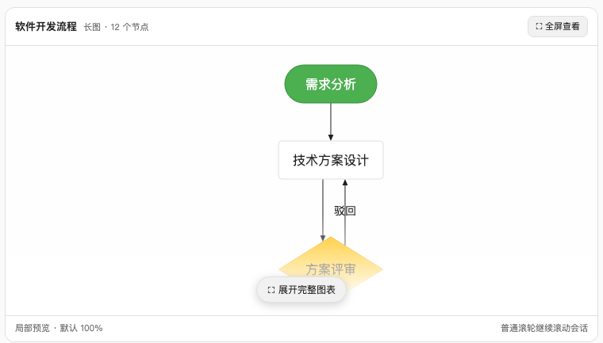
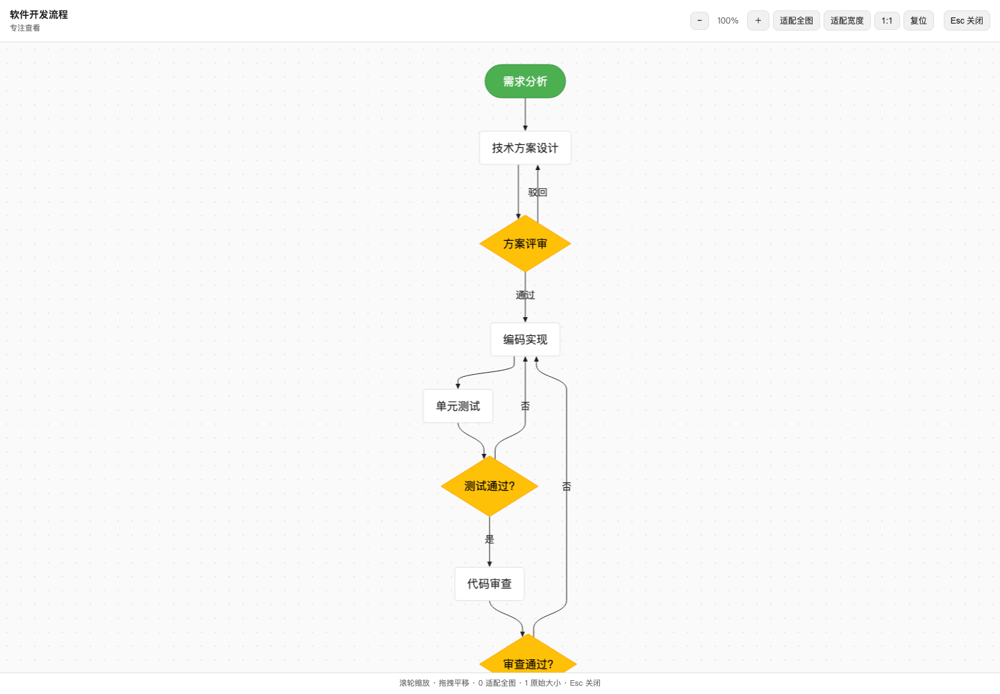
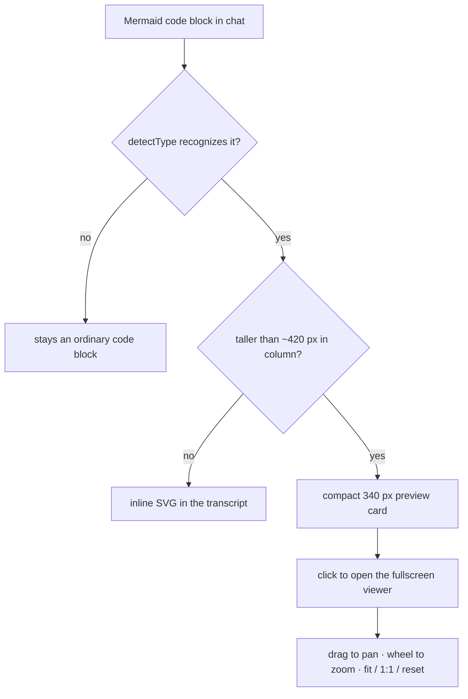

# dsh-pele-mermaid

A DeepSeek Harness plugin that renders [Mermaid](https://mermaid.js.org/)
diagrams inside the Web GUI with [Pele](https://pele.run/) — a fast,
zero-dependency, themeable Mermaid-to-SVG renderer — both in Markdown document
previews and in chat transcripts.

## Screenshots

Tall diagrams collapse into a compact preview card that keeps the diagram
readable (default 100%) without stretching the conversation; ordinary wheel
scrolling still scrolls the chat.

<p align="center">
  
</p>

Clicking the preview opens a frame-wide viewer with drag-to-pan, wheel zoom,
fit-to-diagram / fit-to-width / 1:1 / reset, and Escape to close.

<p align="center">
  
</p>

## What it does

The built-in sidebar document preview renders Markdown files as plain text, so
Mermaid fenced code blocks show up as source. This bundle registers an
alternative preview implementation, `Markdown + Mermaid`, that becomes the
default for `.md`, `.markdown`, `.mmd`, and `.mermaid` files:

- Fenced code blocks tagged `mermaid` render as SVG diagrams via Pele, themed
  from the DSH theme tokens (`--dsw-alias-*`), adapting to light and dark
  themes.
- Everything else renders through the standard `MarkdownText` primitive, so
  headings, code blocks, math, footnotes, and images behave as before.
- `.mmd` / `.mermaid` files render the whole file as one diagram.
- A diagram Pele cannot parse falls back to an error box with the parse
  message; use the viewer dropdown in the preview header to switch back to the
  built-in Markdown renderer at any time.

## Chat transcripts

The built-in chat has no fence-level rendering hook (`MarkdownText` is a closed
primitive), so instead of replacing the whole assistant node view, a hidden
component rides the `conversation.chat.turnTail` list slot and watches the
transcript DOM. Candidate code blocks are identified by shape — an
unhighlighted `pre`, where registered languages render `pre.shiki` or a
highlight div — and by content: Pele's `detectType` must recognize the text as
a diagram. Each accepted block is hidden in place and followed by a sibling
element holding the Pele-rendered SVG. Only DOM the built-in renderer does not
manage (inline style, the inserted sibling) is touched, so streaming, edits,
and React reconciliation keep working. While a source does not parse yet (for
example while it is still streaming in), the ordinary code block stays visible;
the diagram appears as soon as the source parses.

A diagram that would stand taller than ~420 px in the column (after fitting to
the column width) gets a compact 340 px preview instead of stretching the
transcript. The preview keeps the diagram at a readable scale, fades into an
explicit expansion affordance, and never captures ordinary wheel scrolling.
Clicking it opens a frame-wide viewer through `shell.overlay` with drag-to-pan,
wheel zoom, Fit diagram, Fit width, 1:1, Reset, and Escape controls. The viewer
starts at Fit width (capped at 100%) so a very tall diagram stays readable;
Fit diagram remains available for an overview. Shorter diagrams render inline
as before; the document preview keeps its inline rendering.

## Try it

Any fenced `mermaid` block works. GitHub renders the block below natively on
this page; inside DeepSeek Harness the same block is rendered by Pele through
this plugin:



## Install

Requires a DSH runtime matching the `engines.dsh` range in
[`package.json`](package.json) — the DSH installer resolves the lower bound to
the runtime the plugin was packaged against:

```sh
dsh plugin --profile <name> add <path-to-this-package>
```

Restart DSH (or reload the Web GUI) if HMR does not pick the change up.

## Develop

```sh
npm install                      # pele + esbuild + react for building/testing
node scripts/build-client.mjs    # bundle src/client-entry.js -> lib/client.js
node scripts/smoke.mjs           # run the client bundle headlessly
```

The client bundle is hand-targeted at the `window.__ModuleLoader__` factory
format: React and `@deepseek-ai/dsh-client-ui-primitives` resolve against the
web shell's static module table, and Pele is inlined into the bundle.

## License

[MIT](LICENSE)
